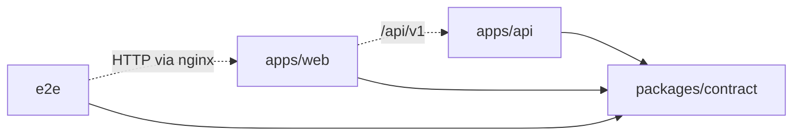
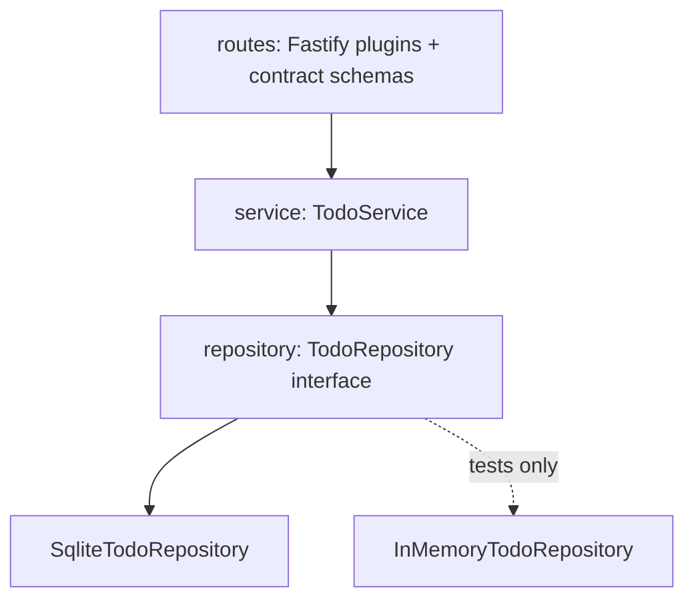
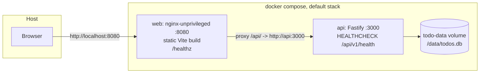
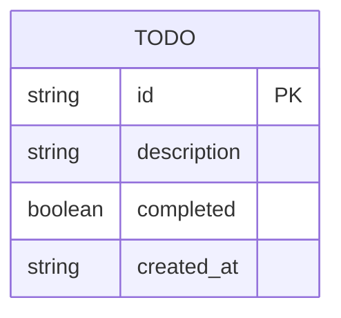

# Architecture Spine — Todo App

## Design Paradigm

**Client-server over REST, one monorepo (this repository's root), three workspaces.**

- `packages/contract` — the contract: types, schemas, paths, error codes. Depends on nothing in the repo.
- `apps/api` — **layered backend**: `routes/` (HTTP edge) -> `service/` (domain rules) -> `repository/` (storage port + SQLite adapter). Depends on `contract`.
- `apps/web` — **thin-client SPA**: `api/` (fetch client) -> `state/` (list + in-flight tracking) -> `components/`. Depends on `contract`. Server is the source of truth; the client holds a cache, never a model.
- `e2e/` — Playwright against the running containers. Depends on `contract` for paths only.



Allowed dependency direction is the arrows above. Nothing depends on `apps/*`; `contract` depends on nothing.

## Invariants & Rules

### AD-1 — The contract package is the only definition of the API [ADOPTED]

- **Binds:** all
- **Prevents:** `api` and `web` each declaring their own `Todo`, paths, or error shape and drifting; apps unable to resolve the package in `tsc` or Docker builds.
- **Rule:** `packages/contract` is the npm workspace `@todo/contract`, ESM, compiled by `tsc` to `dist/` with `exports` and `types` pointing at `dist/`. It exports the `Todo` type, request/response TypeBox schemas, `DESCRIPTION_MAX`, `ErrorCode` as an `as const` object plus union type (no TypeScript `enum`), and the paths as `API_PREFIX = '/api/v1'`, `TODOS_PATH = '/api/v1/todos'`, `todoPath(id)`, `HEALTH_PATH`. `apps/api` registers its plugins under `API_PREFIX` with route strings `/todos` and `/todos/:id`; `apps/web` and `e2e` call `TODOS_PATH` and `todoPath(id)`. The contract is pure type and schema code: the `dist/` it ships is rebuilt by `tsc --watch` in the `dev` profile. `apps/api` builds Fastify route schemas from these exports; `apps/web` types its fetch client from them. Neither app declares a `Todo` type or a literal `/api/v1/...` path. The root `build` script builds `contract` before either app; each app's Dockerfile does the same inside the image.

### AD-2 — REST contract for Todos

- **Binds:** FR-10, FR-1, FR-3, FR-8, FR-9
- **Prevents:** incompatible verbs, status codes, or body shapes between client and server.
- **Rule:**

| Operation | Request | Success |
| --- | --- | --- |
| List | `GET /api/v1/todos` | `200` `Todo[]`, every Todo, no cap, no pagination |
| Create | `POST /api/v1/todos` `{ description }` | `201` `Todo` |
| Update | `PATCH /api/v1/todos/:id` `{ description?, completed? }` | `200` `Todo` |
| Delete | `DELETE /api/v1/todos/:id` | `204` empty |
| Health | `GET /api/v1/health` | `200` `{ status: "ok" }` or `503` `{ status: "degraded" }` |

`Todo = { id: string (UUID v4, API-assigned), description: string, completed: boolean, createdAt: string (ISO 8601 UTC, API-assigned, immutable) }`. Success bodies are bare JSON, no envelope. Paths have no trailing slash. Body schemas in `contract` set `additionalProperties: false`; the `PATCH` body also sets `minProperties: 1`, so `{}` and unknown fields are `VALIDATION_ERROR`, never stripped (`buildApp` sets Ajv `removeAdditional: false`, `coerceTypes: false`). With both fields, both apply. An `:id` that is not a known Todo, whether malformed or merely absent, is `NOT_FOUND`. No other endpoints in v1.

### AD-3 — One error envelope, fixed code set, client owns user-facing copy

- **Binds:** FR-10, FR-14, NFR-Reliability
- **Prevents:** handlers inventing error shapes; the client parsing status codes ad hoc; raw validator or proxy text reaching the user.
- **Rule:** Every non-2xx body from a Todo route is `{ code, message }`. `code` is one of `VALIDATION_ERROR` (400), `NOT_FOUND` (404), `INTERNAL_ERROR` (500), defined in `contract`. One Fastify `setErrorHandler` and one `setNotFoundHandler` produce the envelope; route handlers never build error bodies; the handler maps schema failures, malformed JSON, and unsupported content types to `400 VALIDATION_ERROR`, unknown routes to `404 NOT_FOUND`, everything else to `500 INTERNAL_ERROR`, and rewrites any library-supplied `code` or message. The health route is the only exception and returns `{ status }`. `message` is for logs and developers; the web never displays it. The web's `api/` client parses the envelope when present and treats any other non-2xx or non-JSON response (nginx `502`, network failure) as `INTERNAL_ERROR`; it never throws past its own boundary. User-facing copy is authored in `apps/web`, keyed by action plus `code`, and names the failed action.

### AD-4 — Backend layering and dependency direction

- **Binds:** apps/api, FR-2, FR-10, FR-11
- **Prevents:** domain rules scattered across handlers; SQL leaking into routes; untestable handlers.
- **Rule:** `routes` -> `service` -> `repository`, downward only. Routes parse HTTP and call `TodoService`; they contain no business rules. `TodoService` owns every domain rule (trim, length, not-found, ordering guarantee) and is the only caller of `TodoRepository`. `TodoRepository` is an interface in `repository/`; `SqliteTodoRepository` implements it and contains SQL only. An `InMemoryTodoRepository` is permitted for unit tests only. `buildApp(deps)` in `app.ts` receives the repository; `server.ts` is the only place env is read and `listen` is called.



### AD-5 — Persistence: one SQLite file, durable before reply

- **Binds:** FR-11, FR-13, NFR-Reliability, NFR-Deployability, PRD Open Question 1 (resolved here)
- **Prevents:** a second datastore; divergent restart semantics; in-memory "persistence"; a root-owned volume the non-root process cannot write.
- **Rule:** `SqliteTodoRepository` uses `better-sqlite3` on the file at `DB_PATH` (container default `/data/todos.db`, on the named volume `todo-data`). One connection per process, WAL journal mode, `synchronous = FULL`; the API responds to a write only after the statement has committed. Restart semantics: an API or container restart with the same volume shows the same list; `docker compose down -v` is the only way to lose data. All SQL is prepared statements with bound parameters; no input is ever interpolated into SQL text. Schema is created idempotently at startup (`CREATE TABLE IF NOT EXISTS`); no migration tool in v1. Only `apps/api` opens the database. The api Dockerfile creates `/data` and `chown`s it to the runtime user before `USER`.

### AD-6 — Description is untrusted text, validated once on the server

- **Binds:** FR-2, NFR-Security, FR-15, PRD Open Question 2 (500 pending product-owner confirmation)
- **Prevents:** client-only validation; HTML rendering of user input; two definitions of "valid".
- **Rule:** The server trims, then requires 1 to `DESCRIPTION_MAX` (500) characters; anything else is `VALIDATION_ERROR`. The limit is one constant in `contract`. The service applies this rule and stores the trimmed value; the route schema enforces `string` type only. The client sends `description.trim()` and blocks submit locally only for the two cases FR-2 names, empty after trim and over `DESCRIPTION_MAX`, using the same constant and the same message mechanism as a server rejection. The web renders `description` exclusively as text content; no `dangerouslySetInnerHTML`, no markdown.

### AD-7 — Server is truth; client patches from responses; one list state machine

- **Binds:** FR-1, FR-4, FR-5, FR-8, FR-9, FR-11, FR-14, FR-15, NFR-Performance
- **Prevents:** optimistic state with ad hoc rollback; refetch storms; two tabs disagreeing; a load failure with no way back.
- **Rule:** The web holds one list state: `loading | ready | error`. `load()` runs on mount and on the retry control in the load Error State; a failed load shows the Error State in place of the list (FR-14). In `ready`, each successful write replaces, inserts, or removes the affected item using the `Todo` returned by the API; the client never recomputes server-owned fields. No optimistic updates. At most one write is in flight per Todo id: while it is pending, that item's checkbox and delete button are `disabled` and no action is queued; while a create is pending the submit control is disabled. "Waits" in FR-11 is satisfied by disabling, not queuing. On write failure the list stays at its last persisted state and a non-blocking error message naming the action is shown; a failed create leaves the input text and focus intact. A `NOT_FOUND` on `PATCH` or `DELETE` removes the item locally and shows the message.

### AD-8 — List order is an API guarantee

- **Binds:** FR-3
- **Prevents:** client and server sorting differently; tests asserting against unstable order.
- **Rule:** `GET /todos` returns items ordered by `createdAt` descending, then insertion order descending as the tie-break (`ORDER BY created_at DESC, rowid DESC`); `created_at` is stored with millisecond precision. `completed` is stored as `INTEGER` 0/1 and mapped to a boolean in the repository; the API never emits 0/1. The web renders in received order and never re-sorts. New items created via `POST` are inserted at index 0 by the client.

### AD-9 — Single origin: `/api` is proxied, the client never knows the API host

- **Binds:** apps/web, NFR-Deployability, e2e
- **Prevents:** CORS configuration; API base URLs baked into builds; E2E and prod using different URLs; a 502 from a proxy pointing at the wrong host.
- **Rule:** The browser only ever talks to the web origin. `nginx` in the web container serves the Vite build and proxies `/api/` to `http://api:3000` unchanged: `location /api/ { proxy_pass http://api:3000; }` with no trailing slash, no `rewrite`, `proxy_http_version 1.1`, `proxy_intercept_errors off`. nginx also sends `X-Content-Type-Options: nosniff` and `Content-Security-Policy: default-src 'self'`. The Vite dev server proxies `/api/` to `API_PROXY_TARGET`, read in `vite.config.ts` from `process.env` (no `VITE_` prefix, so it is never inlined into the bundle), default `http://localhost:3000`, and listens with `server.host: true` so a published container port works. `apps/web` builds every URL from the relative path constants in `contract`. The API enables no CORS.

### AD-10 — No single-list assumption

- **Binds:** FR-12, apps/api
- **Prevents:** code that must be rewritten to add owners or auth.
- **Rule:** No `ownerId` in v1. All repository reads and writes go through one scope-aware query path inside `SqliteTodoRepository` so an owner filter is a one-place change. `TodoService` receives its `TodoRepository` by injection; nothing holds a module-level singleton list. Route handlers assume nothing about who owns a Todo.

### AD-11 — Operational envelope: env-only config, JSON logs, one health owner, compose shape

- **Binds:** FR-13, NFR-Deployability, NFR-Maintainability, §6 "runs via docker-compose up"
- **Prevents:** config files per environment; a server bound to loopback inside its container; two definitions of container health; a compose file that does nothing on a bare `up`.
- **Rule:**
  - `apps/api` reads only `HOST` (default `0.0.0.0`), `PORT` (`3000`), `DB_PATH` (`/data/todos.db`), `LOG_LEVEL` (`info`), `NODE_ENV` from the environment; no config files; `listen({ host: HOST, port: PORT })`.
  - Logging is pino JSON to stdout via Fastify's logger; every request emits exactly one completion line with `method`, `url`, `statusCode`, `responseTime`. Containers keep `info` so `docker compose logs` is never empty.
  - `GET /api/v1/health` executes `SELECT 1` on the open SQLite connection and returns `200` only on success, else `503`.
  - Container health has one owner: the `HEALTHCHECK` in each Dockerfile, with `--interval=5s --timeout=3s --start-period=5s --retries=10`. Compose declares no `healthcheck:` and uses `depends_on: { api: { condition: service_healthy } }` on `web`. api check: `node -e` using global `fetch` against `http://127.0.0.1:3000/api/v1/health` (no curl in the image). web check: busybox `wget -qO- http://127.0.0.1:8080/healthz`, a static `200` location in the server config.
  - Both Dockerfiles are multi-stage and run as a non-root user (api: `node`; web: the `nginx-unprivileged` image's user, listening on `8080`). Build recipe is AD-13.
  - Compose: the unprofiled services `api` and `web` are the built images and are what a bare `docker compose up` runs; host publishes `web` on `${WEB_PORT:-8080}` only. The `dev` profile adds `api-dev` (publishes `3000`) and `web-dev` (publishes `5173`, `API_PROXY_TARGET=http://api-dev:3000`); both mount the repo root at `/app` with anonymous volumes over every `node_modules` and run `npm ci` then the workspace `dev` script on start, so native modules are built for the container, never copied from the host. `api-dev` runs `tsc --watch` for `contract` alongside `tsx watch` for the api. Environments differ only by profile and env vars; `.env.example` documents every var.
  - E2E and CI run the unprofiled stack under its own compose project name (`-p todo-e2e`) with `WEB_PORT=8081`, which namespaces the `todo-data` volume and avoids the default stack's port; the `test:e2e` script owns the lifecycle: `down -v`, then `up --build --wait` (readiness comes from the two `HEALTHCHECK`s, never from polling `/healthz`), then Playwright with `baseURL http://localhost:8081`, then `down -v`. Playwright declares no `webServer`.

### AD-12 — Every test level has one home

- **Binds:** NFR-Maintainability, addendum B
- **Prevents:** tests duplicated across levels; E2E that never exercises the shipped images; coverage counted across packages; flaky E2E from shared state.
- **Rule:**

| Level | Home | Runner | Boundary |
| --- | --- | --- | --- |
| Unit (api) | `apps/api/src/**/*.test.ts` | Vitest | `TodoService` against `InMemoryTodoRepository` |
| Unit (web) | `apps/web/src/**/*.test.tsx` | Vitest + jsdom + Testing Library | components with the `api/` client mocked |
| Integration | `apps/api/test/*.int.test.ts` | Vitest, `fastify.inject` | `buildApp` with `SqliteTodoRepository` on a temp file per test file; one spec per endpoint |
| E2E | `e2e/*.spec.ts` | Playwright, `workers: 1` | compose project `todo-e2e` via `http://localhost:8081`; `beforeEach` purges via the API (list, then delete each); API failures via `page.route` interception |

Vitest sets `LOG_LEVEL=silent`. Coverage: `@vitest/coverage-v8`, threshold 70% lines and branches per app, enforced by the root `test` script. Minimum five E2E specs: create, complete, delete, empty state, error handling. The 200-item figure from the PRD is the size of the performance fixture, not a server cap.

### AD-13 — One container build recipe for the workspace monorepo

- **Binds:** both Dockerfiles, `docker-compose.yml`, NFR-Deployability
- **Prevents:** a compose `build:` and a Dockerfile `COPY` that disagree about the build context; a runtime image with a dangling `@todo/contract` link or a native rebuild on musl without a toolchain; the main nginx config being overwritten.
- **Rule:** Every image builds from the repo root: compose sets `build: { context: ., dockerfile: apps/<app>/Dockerfile }`; a root `.dockerignore` excludes `node_modules`, `dist`, `_bmad*`, `docs`, `e2e`, `.git`. Stage `deps`: copy root `package.json`, `package-lock.json`, and every workspace `package.json` (`packages/contract`, `apps/api`, `apps/web`), then `npm ci` (full, dev deps included; native modules compile here on `node:24-alpine` with `python3 make g++` installed in this stage only). Stage `build`: copy `packages/contract` and the app's source, run `npm run build -w packages/contract` then `-w apps/<app>`, then `npm prune --omit=dev`. Stage `runtime` (api): `node:24-alpine`, copy `/app` from `build` keeping the workspace layout so the `node_modules/@todo/contract` symlink resolves, never run `npm` again, `mkdir -p /data && chown node:node /data`, `USER node`, `CMD ["node", "apps/api/dist/server.js"]`. Stage `runtime` (web): `nginxinc/nginx-unprivileged:1.30-alpine`, copy `apps/web/dist` to `/usr/share/nginx/html` and `apps/web/nginx.conf` to `/etc/nginx/conf.d/default.conf` as a `server {}` block only; the image's main `nginx.conf` is never replaced.

## Consistency Conventions

| Concern | Convention |
| --- | --- |
| Naming | JSON fields camelCase; SQL columns snake_case mapped in the repository. Files kebab-case (`todo-service.ts`). React components and TS types PascalCase. Test files `*.test.ts(x)`, integration `*.int.test.ts`, E2E `*.spec.ts`. One Fastify plugin per resource under `routes/`. |
| Identifiers | `id` is UUID v4 from `crypto.randomUUID()` in the service, never client-generated. |
| Dates | `createdAt` ISO 8601 UTC with `Z`, set server-side. Not displayed in v1. |
| Errors | `{ code, message }`; codes from `contract`; the web shows its own copy per action and code, never `message`. |
| Validation | Type at the route (contract schema); rules in the service; nothing in the repository. |
| State | Server-owned fields never computed on the client. One in-flight write per Todo id. |
| Logging | pino JSON to stdout, one line per request; `LOG_LEVEL` default `info`; `silent` only under Vitest. |
| Ports | api `3000`, web `8080` inside containers; host publishes `WEB_PORT` (default `8080`, E2E `8081`), plus `3000` and `5173` under the dev profile. |
| Accessibility | Each Todo is a list item with a labelled checkbox and a labelled delete button. Exactly one live region, `role="status"`, rendered by `ErrorBanner` under `App`; it announces API failures and the description validation message. `TodoInput` sets `aria-invalid` and `aria-describedby` pointing at it. E2E locates messages with `getByRole("status")`. Full keyboard path for create, toggle, delete; visible focus. |
| Performance | Confirmed render (AD-7) meets the 100 ms action bound; initial render under 1 s with the 200-item fixture; Lighthouse mobile performance 90 or above. |
| Product completeness, browser support | Page `<title>` set; no unstyled browser defaults; no layout shift on load; Empty, Loading and Error States are designed. E2E and audits run on Chromium; manual smoke on current Firefox and Safari. |
| Styling | Plain CSS modules per component, one `tokens.css` for spacing, colour and type scale, no CSS framework. Mobile-first, single breakpoint. |
| Lint and format | ESLint 10 flat config with `typescript-eslint` and `eslint-plugin-react-hooks`, Prettier for formatting; one root config each; `lint` runs both. |
| Package manager | npm workspaces; one root `package-lock.json`; root scripts `build`, `test`, `test:int`, `test:e2e`, `lint` fan out in dependency order (`contract` first). |
| TypeScript | `tsconfig` per workspace extending `tsconfig.base.json` (`strict`, `erasableSyntaxOnly`, `verbatimModuleSyntax`); ESM (`"type": "module"`); no `enum`, no parameter properties. `contract` and `api`: `module: nodenext`, `types: ["node"]`. `web`: the create-vite `react-ts` settings. `@types/node` tracks the 24 line, never a newer major. |
| Config | Env vars only: `HOST`, `PORT`, `DB_PATH`, `LOG_LEVEL`, `NODE_ENV` (api); `API_PROXY_TARGET` (web-dev); `WEB_PORT` (compose). `.env.example` at repo root is the documented set. |
| Documentation homes | `README.md` (setup, layout, commands); `docs/architecture.md` (readable architecture); `docs/ai-integration-log.md`; `docs/qa/coverage.md`, `docs/qa/accessibility.md`, `docs/qa/security.md`, `docs/qa/performance.md`. |

## Stack

| Name | Version |
| --- | --- |
| Node.js | 24.22.1 (LTS Krypton); image `node:24-alpine` |
| TypeScript | 6.0.3 |
| tsx (api dev runner) | 4.23.15 |
| Fastify | 5.12.7 |
| typebox | 1.4.3 |
| ajv-formats | 3.0.1 |
| @fastify/type-provider-typebox | 6.3.0 |
| @fastify/sensible | 6.0.7 |
| better-sqlite3 / @types/better-sqlite3 | 13.0.3 / 9.6.0 |
| React / react-dom | 19.3.1 |
| @types/react / @types/react-dom | 19.3.0 / 19.3.0 |
| Vite / @vitejs/plugin-react | 8.3.5 / 6.1.2 |
| Vitest / @vitest/coverage-v8 | 5.0.5 / 5.0.5 |
| jsdom | 30.1.3 |
| @testing-library/react / @testing-library/dom | 16.3.3 / 10.4.2 |
| @playwright/test | 1.64.1 |
| @types/node | 24.19.2 |
| concurrently (dev profile) | 10.0.6 |
| ESLint / @eslint/js / typescript-eslint / eslint-plugin-react-hooks | 10.13.0 / 10.0.1 / 8.72.0 / 7.1.1 |
| Prettier | 3.9.10 |
| nginx image | `nginxinc/nginx-unprivileged:1.30-alpine` |
| Docker Compose | v2 (`docker compose`) |

## Structural Seed





```text
/                            # this repository root
  package.json               # npm workspaces; fan-out scripts
  tsconfig.base.json
  docker-compose.yml         # api, web (default); api-dev, web-dev (profile dev); build context .
  .dockerignore
  .env.example
  README.md
  docs/
    architecture.md
    ai-integration-log.md
    qa/
  packages/contract/
    src/todo.ts              # Todo type + TypeBox schemas + DESCRIPTION_MAX
    src/routes.ts            # path constants
    src/errors.ts            # ErrorCode const + error schema
    dist/                    # tsc output, consumed by apps
  apps/api/
    Dockerfile               # deps -> build (contract then api, prune) -> runtime, USER node, HEALTHCHECK (AD-13)
    src/app.ts               # buildApp(deps): plugins, error + not-found handlers, routes
    src/server.ts            # env, repository wiring, listen
    src/routes/todos.ts
    src/routes/health.ts
    src/service/todo-service.ts
    src/repository/todo-repository.ts
    src/repository/sqlite-todo-repository.ts
    src/repository/in-memory-todo-repository.ts
    test/*.int.test.ts
  apps/web/
    Dockerfile               # deps -> build -> nginx-unprivileged runtime
    nginx.conf               # server {} only -> /etc/nginx/conf.d/default.conf: static, /api/ proxy, /healthz
    vite.config.ts           # /api proxy from API_PROXY_TARGET, server.host true
    src/api/todos-client.ts  # fetch wrapper, envelope parsing, in-flight guard
    src/state/use-todos.ts   # loading | ready | error, load/create/toggle/delete
    src/components/          # TodoInput, TodoList, TodoItem, EmptyState, LoadingState, ErrorBanner
    src/App.tsx
  e2e/
    playwright.config.ts     # baseURL http://localhost:8081, workers 1, no webServer
    *.spec.ts
```

## Capability → Architecture Map

| Capability / Area | Lives in | Governed by |
| --- | --- | --- |
| FR-1, FR-2 create + validate | `web/components/TodoInput`, `api/routes/todos`, `api/service` | AD-2, AD-3, AD-6, AD-7 |
| FR-3 list newest first | `api/service`, `api/repository`, `web/state` | AD-8 |
| FR-4, FR-5 empty + loading states | `web/components/EmptyState`, `LoadingState`, `web/state` | AD-7 |
| FR-6, FR-7 visual status + responsive | `web/components/TodoItem`, CSS | Conventions (Accessibility) |
| FR-8 toggle both ways | `PATCH /todos/:id`, `web/state` | AD-2, AD-7 |
| FR-9 delete immediate | `DELETE /todos/:id`, `web/state` | AD-2, AD-7 |
| FR-10 CRUD API + error shape | `contract`, `api/routes`, error handlers | AD-1, AD-2, AD-3 |
| FR-11 durable persistence, one in-flight write | `api/repository/sqlite`, `web/api/todos-client` | AD-5, AD-7 |
| FR-12 extensible to multi-user | `api/service`, `api/repository` | AD-10 |
| FR-13 health endpoint + container health | `api/routes/health`, both Dockerfiles | AD-11 |
| FR-14, FR-15 error states, retry, keep input | `web/components/ErrorBanner`, `web/state`, `web/api` | AD-3, AD-7 |
| NFR-Security | `api/service`, `web/components/TodoItem` | AD-6 |
| NFR-Deployability, §6 compose gate | `docker-compose.yml`, Dockerfiles, `nginx.conf` | AD-9, AD-11, AD-13 |
| NFR-Maintainability, coverage, four test levels | per AD-12 table | AD-12 |
| Graded documents (README, AI log, QA reports) | `README.md`, `docs/` | Conventions (Documentation homes) |

## Deferred

- **Postgres or other store.** Swap `SqliteTodoRepository` behind the `TodoRepository` port when a second instance or shared DB is needed. Not before.
- **Users and auth, `ownerId`.** AD-10 keeps the seam; add the column, the scoped filter, and an auth plugin together.
- **Migrations tool.** `CREATE TABLE IF NOT EXISTS` suffices until a second schema version exists.
- **Pagination, filtering, sorting controls, "clear completed", undo.** PRD §8.2 out of scope.
- **UI editing of description.** PRD Open Question 4. API already supports it via PATCH.
- **Displaying `createdAt`.** PRD Open Question 5.
- **`prod` profile, TLS, reverse proxy in front of nginx.** Brief grades the default stack and dev only.
- **CI provider and pipeline shape.** Root scripts are the contract; the runner is a later choice.
- **Rate limiting, request size limits beyond Fastify defaults.** Single-user deployment.
- **QA and authoring tooling**: Lighthouse vs axe, Playwright MCP (E2E authoring), Postman MCP (contract checks through `http://localhost:8080/api/v1`), Chrome DevTools MCP (debugging, performance report). Chosen in the setup and QA stories, recorded in `docs/ai-integration-log.md`; they produce the `docs/qa/*` reports, they do not shape the system.
