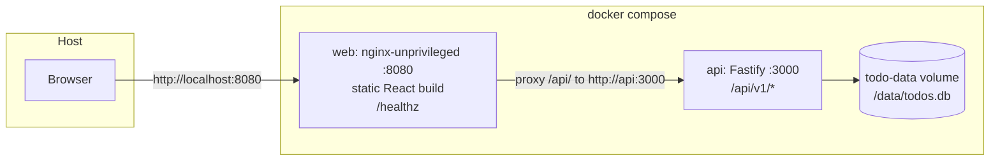
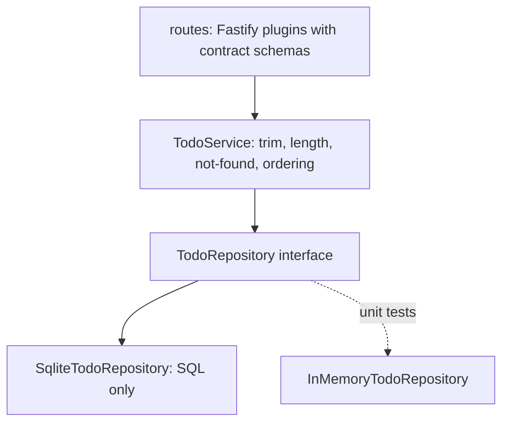

# Todo App Architecture

This document explains how the Todo App v1 is built and why. It is the readable companion to the architecture spine, the terse contract that implementation agents follow. Where the two differ, the spine wins. Readers: the training reviewer, the story author, and anyone joining the project.

Inputs: the refined PRD and its addendum, the course PRD at `/PRD.md`, and the training brief at `/CONTEXT.md`.

## 1. Shape of the system

One repository, three npm workspaces, two containers.



- **`packages/contract`** holds the API contract as code: the `Todo` type, request and response schemas, route paths, the error code set, and the Description length limit. Both apps import it. It depends on nothing.
- **`apps/api`** is a Fastify service in three layers: routes (HTTP in, HTTP out), a `TodoService` that owns every domain rule, and a `TodoRepository` interface with a SQLite implementation.
- **`apps/web`** is a single-screen React app: a fetch client, one list state, and a handful of components. It never holds a model of its own; the server is the source of truth.
- **`e2e/`** runs Playwright against the real containers.

The browser only ever sees one origin. nginx serves the built frontend and proxies `/api/` to the API container. There is no CORS and no API URL baked into the build.

### Stack

| Part | Choice |
| --- | --- |
| Runtime | Node.js 24.22.1 (`node:24-alpine`), TypeScript 6.0.3, ESM throughout |
| API | Fastify 5.12.7, TypeBox 1.4.3 schemas, better-sqlite3 13.0.3 |
| Web | React 19.3.1, Vite 8.3.5, plain CSS modules |
| Tests | Vitest 5.0.5 with v8 coverage, Testing Library 16.3.3, Playwright 1.64.1 |
| Lint and format | ESLint 10.13.0, Prettier 3.9.10 |
| Containers | `nginxinc/nginx-unprivileged:1.30-alpine`, Docker Compose v2 |

The spine's Stack table pins every package version.

## 2. Decisions and why

The spine records decisions without rationale. The rationale lives here and in the run's memlog.

| Decision | Chosen | Alternatives weighed | Why |
| --- | --- | --- | --- |
| Persistence | SQLite file on a named volume, via `better-sqlite3`, behind a repository interface | Postgres container; SQLite now with a Postgres profile | One fewer service, trivial restart semantics for FR-11, boring technology. The repository port keeps Postgres a swap, not a rewrite. Resolves PRD Open Question 1. |
| Backend framework | Fastify 5 | Hono 4, Express 5 | JSON-schema validation gives the PRD's 400 behaviour for free; pino logging gives the per-request log line the brief grades; strong TypeScript. |
| Frontend | Vite + React 19 + TypeScript, no router, no state library | Vue 3, Svelte 5 | Paved path for agents and graders; one screen needs no routing; Vitest and Testing Library cover component tests. |
| Repo shape | npm workspaces monorepo with a shared contract package | Monorepo with OpenAPI only; two repos | The biggest divergence risk is the API contract drifting between two independently built apps. Shared types close it. |
| API style | REST, `/api/v1/todos`, UUID ids, ISO 8601 UTC timestamps, PATCH partial update, bare JSON bodies, `{ code, message }` errors | PUT full replace; integer ids | PATCH matches the two independent user actions (toggle, edit). UUIDs do not leak ordering and survive multi-user later. |
| Frontend state | Server is truth; each write patches the list from the returned Todo; no optimistic updates | Refetch after every write; optimistic with rollback | Meets the 100 ms bound on a local stack without rollback logic the PRD warns against. Disabling controls, not queuing, enforces one in-flight write per Todo. |
| Backend layering | routes, service, repository | routes and repository only | Keeps domain rules in one place and makes the service unit-testable against an in-memory repository. |
| Serving topology | nginx serves static files and proxies `/api/` | Separate ports with CORS | Single origin, same URL in dev, E2E and production, no CORS plugin. |
| Multi-user readiness | No `ownerId` column; a rule that no code path assumes one list | Nullable `ownerId` now | No dead field in v1; the repository's single scoped query path makes an owner filter a one-place change. |
| Config and ops | Env vars only; pino JSON to stdout; health = `SELECT 1`; one `HEALTHCHECK` owner per image | Config files; compose-level health checks | Dev and test differ only by env and compose profile, as the brief requires. One health owner avoids two definitions of "healthy". |
| Compose shape | Default services are the built images; a `dev` profile adds hot-reload services | "dev as default profile" | Compose has no default profile: unprofiled services always run, profiled ones need a flag. The graded `docker compose up` must run the built images. |

## 3. API contract

Base path `/api/v1`. All bodies are JSON. Paths have no trailing slash.

| Operation | Request | Success |
| --- | --- | --- |
| List | `GET /todos` | `200` array of Todo, newest first, every item |
| Create | `POST /todos` `{ "description": "…" }` | `201` Todo |
| Update | `PATCH /todos/:id` `{ "description"?: "…", "completed"?: true }` | `200` Todo |
| Delete | `DELETE /todos/:id` | `204` |
| Health | `GET /health` | `200` `{ "status": "ok" }` or `503` `{ "status": "degraded" }` |

```json
{
  "id": "6f1c2a0e-5d3b-4c8a-9e2f-1b7d4a9c3e10",
  "description": "Send invoice to Kerr",
  "completed": false,
  "createdAt": "2026-10-26T11:42:07.512Z"
}
```

Every error body is `{ "code": "...", "message": "..." }` with one of three codes:

| Code | Status | When |
| --- | --- | --- |
| `VALIDATION_ERROR` | 400 | Wrong type, unknown field, empty PATCH body, malformed JSON, unsupported content type, Description empty after trim or over 500 characters |
| `NOT_FOUND` | 404 | Unknown route, or an id that is malformed or absent |
| `INTERNAL_ERROR` | 500 | Anything unexpected; the message is generic |

The client trims the Description before sending it. The server trims it again before validating and stores the trimmed value. The 500-character cap is one constant in the contract package. It is still pending product-owner confirmation (PRD Open Question 2).

The server's `message` is for logs. The web shows its own copy, keyed by the action and the code. A user never sees validator text, stack traces, or a proxy's HTML error page.

## 4. Backend



- **Routes** validate shape with schemas from the contract package and call the service. One error handler and one not-found handler produce every error body; routes never build one.
- **Service** owns the rules: trim, 1 to 500 characters, not-found, newest-first ordering. It receives its repository by injection; nothing holds a module-level list.
- **Repository** is SQL only: prepared statements with bound parameters, one connection per process, WAL journal, synchronous writes. Startup creates the one table with `CREATE TABLE IF NOT EXISTS`; there is no migration tool yet. Columns are snake_case (`id`, `description`, `completed` as 0/1, `created_at`) and the repository maps them to the camelCase `Todo`.
- **Server** is the only place that reads environment variables: `HOST` (`0.0.0.0`), `PORT` (`3000`), `DB_PATH` (`/data/todos.db`), `LOG_LEVEL` (`info`), `NODE_ENV`.

Every request produces one pino JSON log line with method, URL, status code, and response time. `GET /api/v1/health` runs `SELECT 1` and returns `200` only if that succeeds, else `503`.

## 5. Frontend

One screen, one list state machine: `loading`, `ready`, `error`.

- On mount the app loads the list and shows the Loading State while it waits. A failed load shows the Error State with a retry control in place of the list. An empty list shows the Empty State.
- Each successful create, Completion Status toggle, or delete patches the local list from the Todo the API returns. The client never computes anything the server owns. A new Todo goes to the top of the list.
- A pending write disables that Todo's checkbox and delete button. A pending create disables the submit control. Disabling, not queuing, enforces one in-flight write per Todo.
- A failed write leaves the list at its last saved state and shows a non-blocking message naming the action. A failed create keeps the typed text and focus in the input. A `NOT_FOUND` on toggle or delete removes the Todo locally and shows the message.
- The web renders Description text as text, never as HTML.

Components: `TodoInput`, `TodoList`, `TodoItem`, `EmptyState`, `LoadingState`, `ErrorBanner`. Exactly one live region (`role="status"`) in `ErrorBanner` announces errors and validation messages to assistive technology. Styling is plain CSS modules with one `tokens.css`; no CSS framework.

Targets the frontend must meet:

- Each Todo is a list item with a labelled checkbox and a labelled delete button.
- Create, toggle, and delete all work from the keyboard with visible focus.
- A confirmed action renders within 100 ms; the first render stays under 1 s with the 200-item fixture.
- Lighthouse mobile performance scores 90 or above.
- Page title set, no unstyled browser defaults, no layout shift on load.

## 6. Containers and environments

Both images build from the repository root so they can see the whole workspace. The build has three stages. The first installs everything. The second builds the contract, then the app, and prunes dev dependencies. The third copies the result into a small runtime image. Neither image runs `npm` at runtime.

- **api**: `node:24-alpine`, runs as `node`, owns `/data` on the `todo-data` volume, `HEALTHCHECK` calls its own health route with Node's built-in `fetch`.
- **web**: `nginxinc/nginx-unprivileged:1.30-alpine`, non-root by default, listens on 8080, `HEALTHCHECK` hits a static `/healthz`. The server block proxies `/api/` to `http://api:3000` and sets `X-Content-Type-Options: nosniff` and a `default-src 'self'` Content Security Policy.

Compose:

| Service | Profile | What it is | Host port |
| --- | --- | --- | --- |
| `api` | none (always) | built image | none |
| `web` | none (always) | built image, waits for `api` healthy | `WEB_PORT` (8080) |
| `api-dev` | `dev` | repo mounted, `tsx watch` plus contract `tsc --watch` | 3000 |
| `web-dev` | `dev` | repo mounted, Vite dev server proxying to `api-dev` | 5173 |

`docker compose up` runs the two built images: this is the graded command. `docker compose --profile dev up` adds hot reload. Dev services mount the repository and keep `node_modules` in anonymous volumes. Native modules therefore compile inside the container and are never copied from the host. `.env.example` at the repo root documents every variable.

## 7. Tests

| Level | Where | Tool | What it proves |
| --- | --- | --- | --- |
| Unit (api) | `apps/api/src/**/*.test.ts` | Vitest | Service rules against an in-memory repository |
| Unit (web) | `apps/web/src/**/*.test.tsx` | Vitest, jsdom, Testing Library | Components with the fetch client mocked |
| Integration | `apps/api/test/*.int.test.ts` | Vitest, `fastify.inject` | Every endpoint against a real temp SQLite file |
| E2E | `e2e/*.spec.ts` | Playwright | Create, complete, delete, Empty State, error handling, through nginx against the built images |

Vitest measures coverage per app with the v8 provider and gates at 70% lines and branches. E2E runs the built images under its own compose project name on host port 8081. It starts from an empty volume, waits for both health checks, purges all Todos before each test, and runs with one worker. E2E simulates API failures with Playwright route interception, so the API has no test endpoint.

## 8. Deferred decisions

- Postgres or any other store (swap behind the repository interface when needed).
- Users, authentication, and an `ownerId` column.
- A migrations tool.
- Pagination, filtering, sorting, "clear completed", undo, editing a Description in the UI, showing `createdAt`.
- A `prod` profile, TLS, or anything in front of nginx.
- Rate limiting and request size limits beyond Fastify defaults.
- CI provider. The root scripts (`build`, `test`, `test:int`, `test:e2e`, `lint`) are the interface a pipeline calls.
- Which audit tools produce the QA reports (Lighthouse or axe, Chrome DevTools MCP, Postman MCP, Playwright MCP). The QA stories choose them and record the choice in the AI integration log.

## 9. Where things live

| Document | Path |
| --- | --- |
| Architecture spine (binding) | `_bmad-output/planning-artifacts/architecture/architecture-bmad-method-2026-10-26/ARCHITECTURE-SPINE.md` |
| This document | same folder, `architecture.md`; copied to `docs/architecture.md` at project setup |
| Decision log | same folder, `.memlog.md` |
| Review reports | same folder, `reviews/` |
| README, AI integration log, QA reports | `README.md`, `docs/ai-integration-log.md`, `docs/qa/` once the repo is scaffolded |
